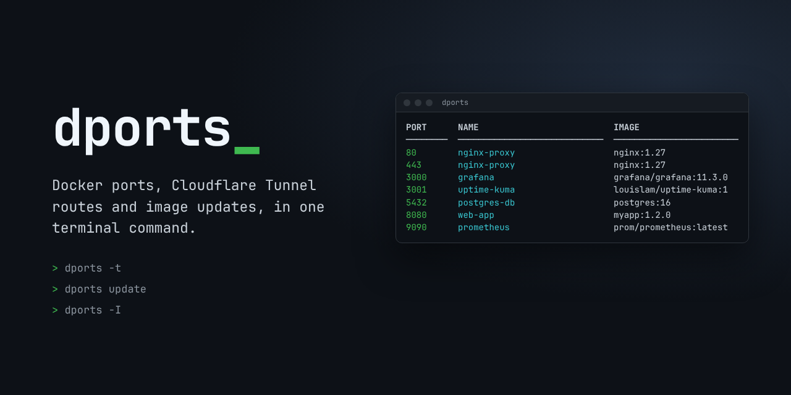
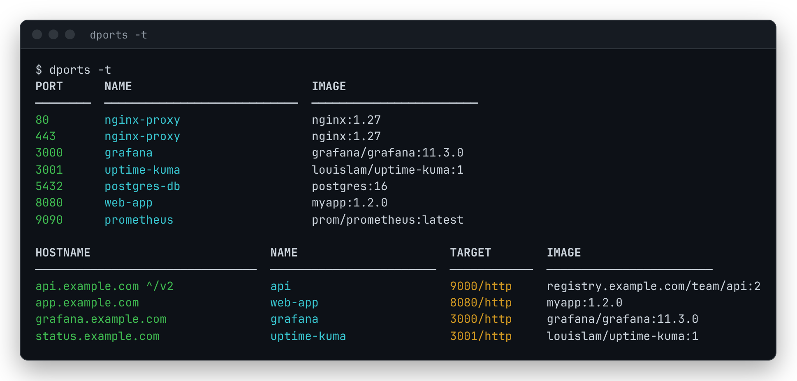
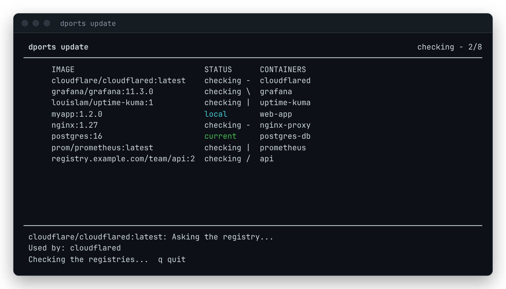
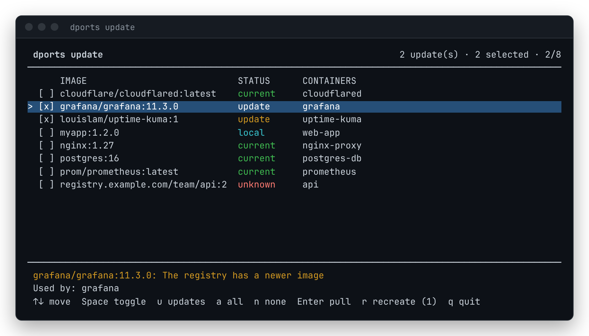
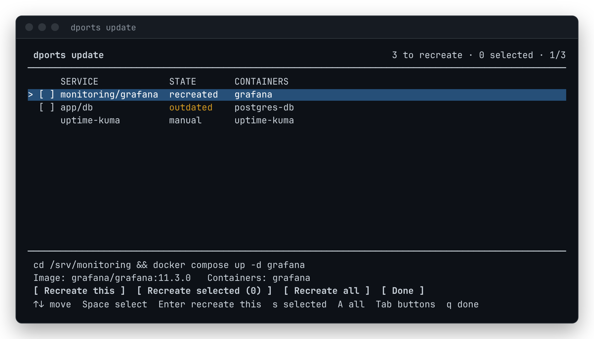
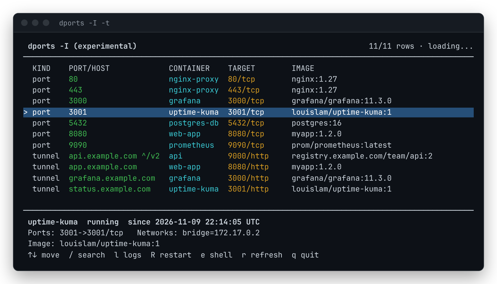

<p align="center"></p>

[English](README.md) | **한국어**

# dports

Docker 포트 매핑, Cloudflare Tunnel 경로, 이미지 업데이트를 터미널 명령 하나로 확인하고 관리합니다.

## 소개

dports는 홈랩, VPS, 라즈베리 파이처럼 직접 운영하는 서버에서 컨테이너를 돌리는 사람을 위한 작은 명령줄 도구입니다. 웹 UI나 에이전트 없이 매일 생기는 세 가지 질문에 답합니다.

- **어떤 컨테이너가 어느 포트를 쓰고 있나?** `docker ps`는 컨테이너 하나의 모든 포트 매핑을 긴 열 하나에 몰아서 보여줍니다. dports는 공개된 포트마다 한 줄씩 정렬해서 보여주고, 포트, 이름, 이미지로 거를 수 있으며, 스크립트용으로 JSON이나 포트 번호만 출력할 수도 있습니다.
- **터널 호스트 이름 뒤에는 무엇이 있나?** Cloudflare Tunnel로 공개한 서비스는 호스트 포트가 없어서 포트 목록에 나타나지 않습니다. dports는 cloudflared의 ingress 규칙을 읽어 각 호스트 이름을 실제로 응답하는 컨테이너와 연결해 보여줍니다.
- **이미지가 최신인가?** `dports update`는 실행 중인 컨테이너의 이미지를 레지스트리와 비교하고, 고른 이미지를 받은 뒤, 그 이미지를 쓰는 Compose 서비스를 다시 만드는 과정을 한 화면에서 진행합니다. 예전에 받아 두고 적용하지 않아 옛 이미지로 돌고 있는 컨테이너도 찾아냅니다.

만든 방식:

- **Bash 스크립트 하나, 상주 프로세스 없음.** dports는 `docker` 명령만 호출합니다. 에이전트를 설치하거나 포트를 열거나 컨테이너를 띄우지 않습니다.
- **요청하지 않으면 아무것도 바꾸지 않음.** 조회는 아무것도 변경하지 않습니다. 이미지 받기, 컨테이너 재생성, 재시작은 직접 고른 경우에만 실행됩니다.
- **쓰는 환경 그대로.** Bash, Fish, Zsh가 같은 구현을 쓰고, Fish와 Zsh에서는 Tab 자동완성도 됩니다. SSH 접속 환경, amd64, arm64, armhf, classic과 containerd 이미지 저장소 모두에서 동작합니다.

## 기능

- 실행 중인(또는 전체) 컨테이너의 포트 표, 내부 포트 표시 선택 가능
- 포트, 컨테이너 이름, 이미지 이름으로 필터; 스크립트용 JSON과 단순 출력
- `dports -t`: Cloudflare Tunnel 호스트 이름과 그 뒤의 컨테이너
- `dports update`: 확인, 다운로드, 재생성을 한 화면에서, 또는 `--check` / `--yes --recreate`로 화면 없이
- `dports -I` (실험적): 포트와 Tunnel 경로를 검색, 상세 정보, 로그, 재시작, 셸과 함께 둘러보기

<p align="center"></p>

## 빠른 시작

```bash
dports                  # 실행 중인 컨테이너의 공개 포트
dports -t               # ... 와 Cloudflare Tunnel로 공개한 호스트 이름
dports update           # 이미지 확인, 업데이트 받기, 컨테이너 재생성
dports -I -t            # 전체 화면에서 둘러보기 (실험적)
```

## 설치

### APT 패키지 (Debian/Ubuntu, 권장)

```bash
# 1. 저장소 키 추가
curl -sS "https://git.palnarium.com/api/packages/jonpark0/debian/repository.key" \
  | gpg --dearmor \
  | sudo tee /usr/share/keyrings/forgejo-dports.gpg > /dev/null

# 2. 저장소 추가
ARCH="$(dpkg --print-architecture)"
echo "deb [arch=${ARCH} signed-by=/usr/share/keyrings/forgejo-dports.gpg] https://git.palnarium.com/api/packages/jonpark0/debian stable main" \
  | sudo tee /etc/apt/sources.list.d/dports.list

# 3. 설치
sudo apt update && sudo apt install dports
```

모든 사용자용 `/usr/bin/dports`와 Fish, Zsh 자동완성이 설치됩니다. 업그레이드는 `sudo apt upgrade dports`, 제거는 `sudo apt remove dports`입니다.

### 설치 스크립트 (사용자별)

```bash
bash <(curl -fsSL https://git.palnarium.com/jonpark0/dports/raw/branch/main/install.sh)
```

설치 스크립트는 Bash, Fish, Zsh를 찾아서 어느 셸에 설치할지 고르게 하고(whiptail/dialog 체크리스트 또는 텍스트 메뉴), 같은 릴리스 태그의 파일을 받습니다.

| 명령 | 동작 |
|------|------|
| `install.sh --all` | 찾은 셸 모두에 묻지 않고 설치 |
| `install.sh --bash` / `--fish` / `--zsh` | 셸 하나에만 설치 |
| `install.sh --simple` | whiptail/dialog 대신 텍스트 메뉴 사용 |
| `install.sh uninstall --all` | 사용자별 설치 제거 |
| `install.sh uninstall --apt` | Debian 패키지도 제거 (없으면 먼저 물어봄) |

설치되는 파일:

- Bash: `~/.bash_functions/dports` (`~/.bashrc`에서 불러옴)
- Fish: `~/.config/fish/functions/dports.fish`, `~/.config/fish/completions/dports.fish`, `~/.local/share/dports/dports.bash`
- Zsh: `~/.local/share/dports/dports.zsh` (`~/.zshrc`에서 불러옴), `~/.local/share/dports/zsh/_dports`, `~/.local/share/dports/dports.bash`

### 직접 설치

Bash:

```bash
mkdir -p ~/.bash_functions
cp dports.bash ~/.bash_functions/dports
# 그다음 ~/.bashrc에 추가:
for f in ~/.bash_functions/*; do [ -f "$f" ] && . "$f"; done
```

Fish:

```fish
cp dports.fish ~/.config/fish/functions/
cp completions/dports.fish ~/.config/fish/completions/
```

Zsh (`~/.zshrc`에 추가):

```zsh
source /path/to/dports/dports.zsh   # 같은 폴더의 completions/_dports도 함께 불러옴
```

Fish와 Zsh 함수는 `dports.bash`를 `$DPORTS_BASH`, `~/.local/share/dports/`, 자기 파일과 같은 폴더, `dports` 명령(Debian 패키지) 순서로 찾습니다. 설치 확인은 `dports --version`으로 합니다.

## 사용법

```
dports [OPTIONS]
dports -I [-t] [-a] [FILTERS]
dports update [--check | --yes] [--recreate]
```

| 옵션 | 설명 |
|------|------|
| `-v`, `--verbose` | 내부(컨테이너) 포트도 표시 |
| `-a`, `--all` | 정지된 컨테이너 포함 |
| `-p`, `--port PORT` | 이 호스트 포트만 (정확히 일치) |
| `-n`, `--name NAME` | 컨테이너 이름에 NAME 포함 (대소문자 무시) |
| `-i`, `--image IMAGE` | 이미지 이름에 IMAGE 포함 (대소문자 무시) |
| `-t`, `--tunnel` | Cloudflare Tunnel 경로도 표시 |
| `-c`, `--color` / `-C`, `--no-color` | 색상 강제 / 끄기 |
| `-q`, `--quiet` | 호스트 포트만 한 줄에 하나씩 출력 |
| `-j`, `--json` | JSON 출력 |
| `-I`, `--interactive` | 전체 화면에서 둘러보기 (실험적) |
| `-h`, `--help` / `-V`, `--version` | 도움말 / 버전 |

필터는 함께 쓸 수 있고, 모두 만족하는 항목만 나옵니다.

```bash
dports -v                       # 내부 포트까지 (80 -> 8080/tcp)
dports -p 8080                  # 호스트 포트 8080을 쓰는 컨테이너
dports -n web -i nginx          # 이름에 "web", 이미지에 "nginx"가 들어간 것
dports -a                       # 정지된 컨테이너 포함 (설정된 포트 바인딩)
dports -q | grep -qx 8080 && echo "8080 사용 중"
dports -j | jq '.[] | select(.port == "80")'
dports -c | less -R             # 페이저에서도 색상 유지
```

JSON 출력은 `{"port", "name", "internal", "image"}` 객체의 배열입니다.

## Cloudflare Tunnel 경로

[Cloudflare Tunnel](https://developers.cloudflare.com/cloudflare-one/connections/connect-networks/)로 공개한 컨테이너는 호스트 포트가 없어서 포트 표에 나올 수 없습니다. `-t`를 붙이면 각 터널 호스트 이름을 그 뒤의 컨테이너와 연결한 표가 추가됩니다(위 스크린샷 참고).

- `-v`를 붙이면 `TARGET` 대신 전체 서비스 URL과 cloudflared 컨테이너가 나옵니다.
- `-t -j`와 `-t -q`는 Tunnel 경로만 출력합니다(`hostname`, `path`, `name`, `image`, `port`, `protocol`, `service`, `tunnel`을 담은 JSON, 또는 한 줄에 호스트 이름 하나).
- `-n`, `-i`, `-p`는 대상 컨테이너의 이름, 이미지, 포트로 거릅니다.
- 괄호 안의 이름은 로컬 컨테이너가 아닌 대상입니다. 호스트 이름 `*`는 나머지를 받는 규칙이거나, 호스트 이름을 알 수 없는 quick tunnel입니다.

dports는 실행 중인 `cloudflared` 컨테이너를 찾아 ingress 규칙을 다음 순서로 읽습니다.

1. metrics 서버(`/config`, 포트 20241-20245 또는 `--metrics` / `TUNNEL_METRICS`). 대시보드에서 관리하는(토큰) 터널도 읽을 수 있지만, 리눅스에서 직접 돌리는 Docker(Docker Desktop, rootless Docker, 원격 데몬 제외)와 `curl` 또는 `wget`이 필요합니다.
2. 컨테이너 안의 설정 파일(`--config`, 또는 `/etc/cloudflared/config.yml` 등 기본 위치)을 `docker cp`로 읽습니다.
3. `--url` / `TUNNEL_URL`로 지정한 대상(quick tunnel).

규칙의 서비스(예: `http://web:8080`)는 cloudflared와 같은 네트워크에 있는 컨테이너의 이름, Compose 서비스, 네트워크 별칭, 호스트 이름, IP로 찾습니다. `localhost`는 cloudflared와 네트워크 네임스페이스를 공유하는 컨테이너, 또는 cloudflared가 host 네트워크를 쓸 때는 공개된 포트를 뜻합니다. `host.docker.internal`은 공개된 포트를 뜻합니다.

## 이미지 업데이트

`dports update`는 확인부터 재생성까지 한 화면에서 진행되고, 끝나고 나가면 결과 요약이 터미널에 남습니다.

**1. 확인.** 실행 중인 모든 컨테이너의 이미지를 레지스트리와 동시에 비교하며, 이미지마다 진행 상태가 실시간으로 표시됩니다.

<p align="center"></p>

**2. 선택.** 처음에는 업데이트가 있는 이미지만 선택되어 있습니다. 목록 아래 줄에서 커서가 있는 이미지의 상태 이유를 볼 수 있습니다.

<p align="center"></p>

**3. 다운로드.** 선택한 이미지를 하나씩 받으며, 줄마다 진행 상황과 결과가 표시됩니다.

**4. 재생성.** 이번에 받았든 예전에 받았든, 태그보다 옛 이미지로 돌고 있는 컨테이너가 Compose 서비스 단위로 나옵니다. dports는 프로젝트 폴더에서 `docker compose up -d --no-deps SERVICE`를 실행합니다.

<p align="center"></p>

| 화면 | 키 |
|------|----|
| 이미지 | 위/아래 화살표, `k`/`j` 이동 (PgUp/PgDn, Home/End로 건너뛰기); Space 선택; `u`, `a`, `n` 업데이트만 / 전체 / 해제; Enter 받기; `r` 받지 않고 재생성 화면으로; `q` 종료 |
| 재생성 | Enter 커서가 있는 서비스 재생성; Space 선택; `s` 선택한 것만; `A` 전체; Tab으로 버튼 이동 (왼쪽/오른쪽 화살표, Enter); `q` 완료 |

Docker Compose로 띄우지 않은 컨테이너는 `manual`로 표시됩니다. dports가 원래의 `docker run` 옵션을 알 수 없으므로 직접 다시 만들어야 합니다.

| 상태 | 뜻 |
|------|----|
| `update` | 레지스트리에 이 태그의 새 이미지가 있음 (기본 선택) |
| `current` | 로컬 이미지가 레지스트리와 같음 |
| `pinned` | digest로 지정되어 있어 받아도 바뀌지 않음 |
| `local` | 직접 빌드했거나 파일에서 불러온 이미지: 레지스트리 digest가 없거나 레지스트리에 없음 |
| `unknown` | 레지스트리에 확인할 수 없었거나 답이 분명하지 않음; 목록 아래 줄에 이유가 나옴 |

전체 화면 없이 쓰려면:

```bash
dports update --check              # 결과만 출력 (터미널이 아닐 때도 이렇게 동작)
dports update --yes                # 업데이트가 있는 이미지를 모두 받기
dports update --yes --recreate     # ... 그리고 옛 이미지로 도는 Compose 서비스를 모두 재생성
```

업데이트는 이미지를 받을 때 기록된 digest(`RepoDigests`)를 레지스트리와 비교해서 판단하므로 classic과 containerd 이미지 저장소 모두에서 동작합니다. `docker buildx`가 있으면 그것을 쓰고, 없으면 `docker manifest inspect` 결과를 `jq`나 `python3`로 읽습니다. 레지스트리는 동시에 최대 8개까지, 각각 30초 제한(`DPORTS_TIMEOUT`)으로 조회합니다.

## 전체 화면 둘러보기 (실험적)

`dports -I`는 포트 표(`-t`를 붙이면 Tunnel 경로 포함)를 전체 화면으로 보여줍니다. `-a`, `-p`, `-n`, `-i`도 그대로 쓸 수 있습니다.

<p align="center"></p>

| 키 | 동작 |
|----|------|
| `/` | 검색: 입력하는 대로 걸러짐; Enter로 유지, Esc로 해제 |
| `l` | 컨테이너 로그 (마지막 500줄, 새 출력을 따라감; `f`로 따라가기 켜고 끔) |
| `R` | 컨테이너 재시작 (먼저 확인함) |
| `e` | 컨테이너 안에서 셸 열기 (bash, 없으면 sh); 셸을 나가면 돌아옴 |
| `r` | 즉시 새로고침; 목록은 5초마다 자동으로 새로고침됨 (`DPORTS_REFRESH`, 0이면 끔) |
| `q`, Esc | 종료 |

아래 상세 줄에는 컨테이너의 상태, health, Compose 프로젝트, 모든 포트와 네트워크, 그리고 태그보다 옛 이미지로 돌고 있는지가 나옵니다.

## 요구 사항

- 데몬에 접근할 수 있는 Docker CLI
- Bash 4.3 이상 (Fish 3.0 이상, Zsh 5 이상에서도 Bash로 실행)
- `awk`, `sort`, `uniq`
- `-t`: cloudflared metrics 서버에 접근할 `curl` 또는 `wget`
- `dports update`: `docker buildx`(권장) 또는 `jq` / `python3`; 서비스 재생성에는 Docker Compose v2(`docker compose`)
- 설치 스크립트: `curl` 또는 `wget`; 메뉴용 `whiptail` 또는 `dialog`(선택)

## 문제 해결

**"Cannot connect to Docker daemon"**: Docker를 시작하거나(`sudo systemctl start docker`) 사용자에게 권한을 주세요(`sudo usermod -aG docker $USER` 후 다시 로그인).

**apt가 "Skipping acquire of configured file ... binary-armhf"를 출력함**: 설치 단계처럼 `[arch=$(dpkg --print-architecture)]`를 넣어 저장소 줄을 다시 만들고 `sudo apt update`를 실행하세요.

**설치 후 "command not found: dports"**: `source ~/.bashrc`(Bash), `source ~/.zshrc`(Zsh)를 실행하거나 새 터미널을 여세요. `type dports`(Bash, Zsh) 또는 `functions dports`(Fish)로 불러왔는지 확인할 수 있습니다.

**Zsh에서 Tab 자동완성이 안 됨**: `~/.zshrc`에 `compinit`이 필요합니다(Oh My Zsh 같은 프레임워크는 대부분 자동으로 실행함): `autoload -Uz compinit && compinit`.

**`dports -t`가 ingress 규칙을 읽지 못함**: 컨테이너 안에 설정 파일이 없고 metrics 서버에도 접근할 수 없는 경우입니다. Docker Desktop, rootless Docker, 원격 데몬에서 토큰 터널을 쓰면 정상적으로 생기는 일입니다. 리눅스에서 직접 돌린다면 `curl`이나 `wget`을 설치하고, `--metrics`가 `localhost`에만 묶여 있지 않은지 확인하세요.

**`dports update`에 `unknown`이 나옴**: 체크리스트 아래 줄에 이유가 나옵니다. 보통 `docker login <registry>`를 하지 않은 사설 레지스트리, Docker Hub 익명 요청 한도(`docker login`하면 늘어남), 또는 `docker buildx` 없이 containerd 저장소의 멀티 플랫폼 이미지를 확인한 경우입니다.

**서비스 재생성이 "The Compose project directory is not on this host"로 실패함**: 다른 기기에서 띄웠거나 더 이상 없는 경로에서 띄운 컨테이너입니다(예: 원격 Docker context). 프로젝트가 있는 곳에서 `docker compose up -d`를 실행하세요.

## 개발

```bash
make check   # 문법 검사 (bash; fish, zsh, shellcheck가 있으면 함께), 버전 일치 확인
make test    # 가짜 docker CLI로 테스트: update 로직(bash), 전체 화면과 셸 래퍼를
             # 가상 터미널에서 (python3, zsh, fish가 있으면 함께)
make deb     # dports_<version>_all.deb 빌드
make screenshots   # docs/images의 이미지 다시 생성 (pyte, playwright 필요)
```

스크린샷은 샘플 컨테이너를 흉내 내는 `docs/tools/demo-docker`를 대상으로 실제 dports 출력을 렌더링한 것입니다.

`vX.Y.Z` 태그를 push하면 Forgejo 릴리스 워크플로가 패키지를 빌드해 apt 저장소에 올리고 릴리스를 만듭니다. 변경 이력은 [CHANGELOG.md](CHANGELOG.md)(영문)에 있습니다.

## 라이선스

MIT, [LICENSE](LICENSE) 참고.

만든 사람: yeochoon ([Forgejo](https://git.palnarium.com/JonPark0))
