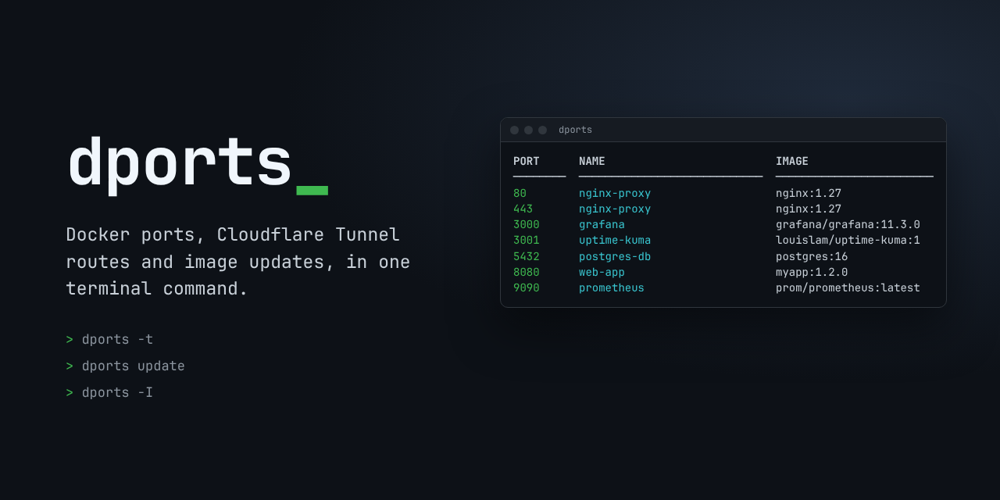
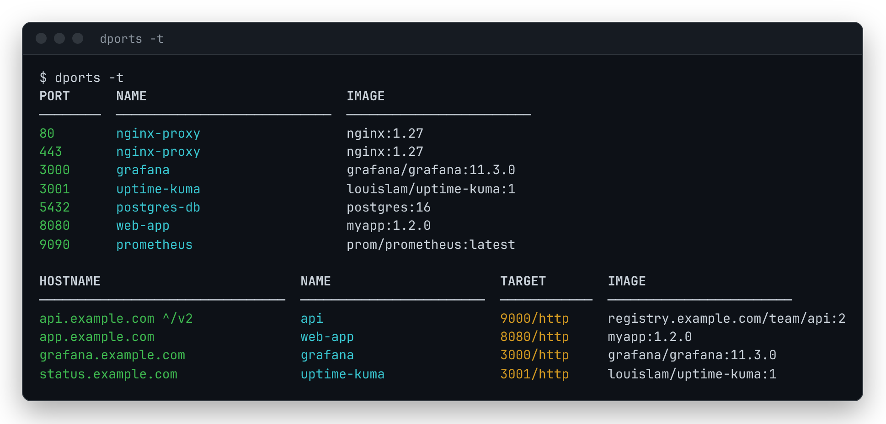
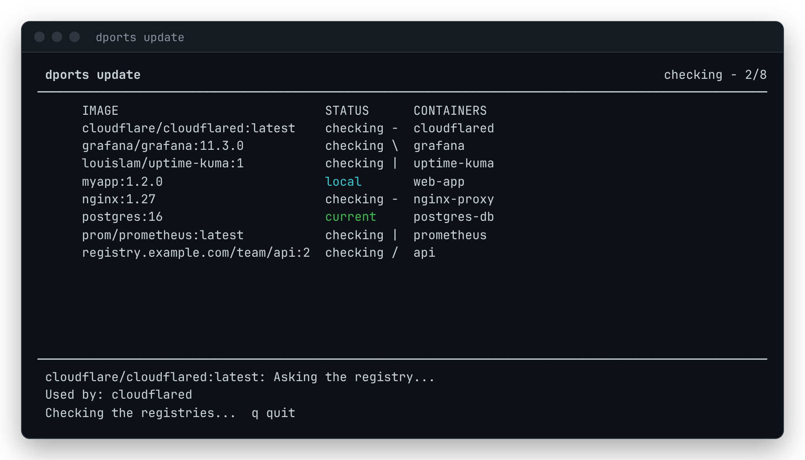
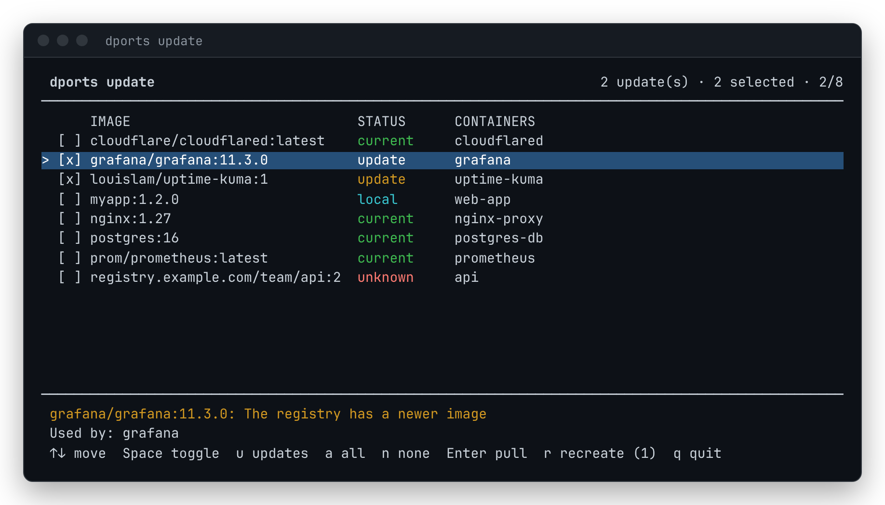
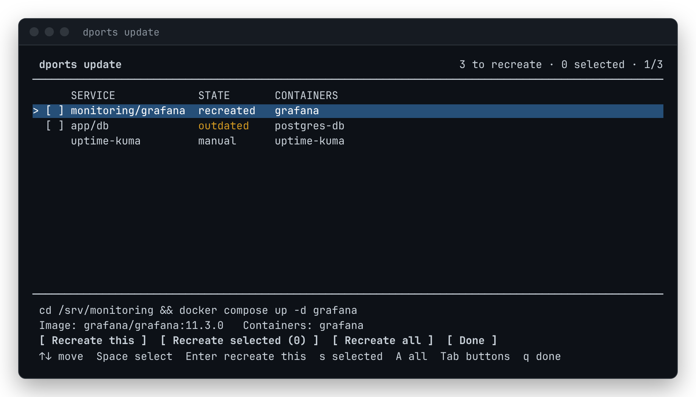
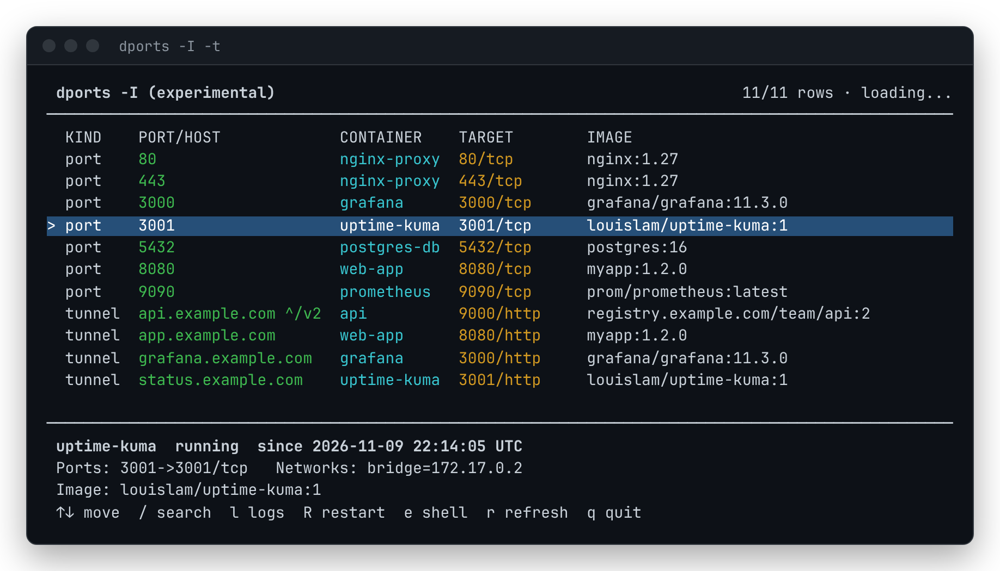

<p align="center"></p>

**English** | [한국어](README.ko.md)

# dports

Docker port mappings, Cloudflare Tunnel routes and image updates, in one terminal command.

## About

dports is a small command-line tool for people who run containers on their own servers: a home lab, a VPS, a Raspberry Pi. It answers three everyday questions without a web UI or an agent:

- **Which container is on which port?** `docker ps` packs every port mapping of a container into one wide column. dports prints one row per published port, sorted, with filters by port, name and image, and as JSON or a plain port list for scripts.
- **What is behind each tunnel hostname?** Services published through Cloudflare Tunnel have no host port, so they never show up in a port list. dports reads cloudflared's ingress rules and matches every hostname to the container that serves it.
- **Are my images up to date?** `dports update` compares each running container's image with its registry, pulls the ones you pick and recreates the Compose services that use them, all in one full-screen flow. It also finds containers still running an older image after an earlier pull.

How it is built:

- **One Bash script, nothing to run in the background.** dports only calls the `docker` CLI. It installs no agent, opens no port and starts no container.
- **Read-only unless you ask.** Listing never changes anything. Pulling, recreating and restarting happen only after you choose them.
- **Works where you work.** Bash, Fish and Zsh share one implementation, with tab completion in Fish and Zsh. It runs over SSH, on amd64, arm64 and armhf, and on both the classic and the containerd image store.

## Features

- Port table for running (or all) containers, with optional internal ports
- Filters by port, container name and image name; JSON and plain output for scripts
- `dports -t`: Cloudflare Tunnel hostnames and the containers behind them
- `dports update`: check, pull and recreate in one full-screen flow, or `--check` / `--yes --recreate` without it
- `dports -I` (experimental): browse ports and tunnel routes with search, details, logs, restart and a shell

<p align="center"></p>

## Quick start

```bash
dports                  # published ports of running containers
dports -t               # ... and the hostnames served through Cloudflare Tunnel
dports update           # check images, pull updates, recreate containers
dports -I -t            # browse everything in a full-screen view (experimental)
```

## Installation

### APT package (Debian/Ubuntu, recommended)

```bash
# 1. Add the repository key
curl -sS "https://git.palnarium.com/api/packages/jonpark0/debian/repository.key" \
  | gpg --dearmor \
  | sudo tee /usr/share/keyrings/forgejo-dports.gpg > /dev/null

# 2. Add the repository
ARCH="$(dpkg --print-architecture)"
echo "deb [arch=${ARCH} signed-by=/usr/share/keyrings/forgejo-dports.gpg] https://git.palnarium.com/api/packages/jonpark0/debian stable main" \
  | sudo tee /etc/apt/sources.list.d/dports.list

# 3. Install
sudo apt update && sudo apt install dports
```

This installs `/usr/bin/dports` for every user, plus Fish and Zsh completions. Upgrade with `sudo apt upgrade dports`, remove with `sudo apt remove dports`.

### Installer script (per user)

```bash
bash <(curl -fsSL https://git.palnarium.com/jonpark0/dports/raw/branch/main/install.sh)
```

The installer detects Bash, Fish and Zsh, lets you choose which to set up (whiptail/dialog checklist, or a text menu), and downloads the files of the matching release tag.

| Command | Effect |
|---------|--------|
| `install.sh --all` | Install for every detected shell without asking |
| `install.sh --bash` / `--fish` / `--zsh` | Install for one shell only |
| `install.sh --simple` | Use the text menu instead of whiptail/dialog |
| `install.sh uninstall --all` | Remove the per-user installation |
| `install.sh uninstall --apt` | Also remove the Debian package (otherwise you are asked first) |

Files installed:

- Bash: `~/.bash_functions/dports`, loaded from `~/.bashrc`
- Fish: `~/.config/fish/functions/dports.fish`, `~/.config/fish/completions/dports.fish`, and `~/.local/share/dports/dports.bash`
- Zsh: `~/.local/share/dports/dports.zsh` (loaded from `~/.zshrc`), `~/.local/share/dports/zsh/_dports`, and `~/.local/share/dports/dports.bash`

### Manual installation

Bash:

```bash
mkdir -p ~/.bash_functions
cp dports.bash ~/.bash_functions/dports
# then add to ~/.bashrc:
for f in ~/.bash_functions/*; do [ -f "$f" ] && . "$f"; done
```

Fish:

```fish
cp dports.fish ~/.config/fish/functions/
cp completions/dports.fish ~/.config/fish/completions/
```

Zsh (in `~/.zshrc`):

```zsh
source /path/to/dports/dports.zsh   # also loads completions/_dports next to it
```

The Fish and Zsh functions look for `dports.bash` in `$DPORTS_BASH`, `~/.local/share/dports/`, next to themselves, and as the `dports` command (Debian package). Check the installation with `dports --version`.

## Usage

```
dports [OPTIONS]
dports -I [-t] [-a] [FILTERS]
dports update [--check | --yes] [--recreate]
```

| Option | Description |
|--------|-------------|
| `-v`, `--verbose` | Also show the internal (container) port |
| `-a`, `--all` | Include stopped containers |
| `-p`, `--port PORT` | Only this host port (exact match) |
| `-n`, `--name NAME` | Container name contains NAME (case-insensitive) |
| `-i`, `--image IMAGE` | Image name contains IMAGE (case-insensitive) |
| `-t`, `--tunnel` | Also show Cloudflare Tunnel routes |
| `-c`, `--color` / `-C`, `--no-color` | Force or disable colors |
| `-q`, `--quiet` | Print host ports only, one per line |
| `-j`, `--json` | Print JSON |
| `-I`, `--interactive` | Browse in a full-screen view (experimental) |
| `-h`, `--help` / `-V`, `--version` | Help / version |

Filters can be combined; all of them must match.

```bash
dports -v                       # with the internal port (80 -> 8080/tcp)
dports -p 8080                  # who uses host port 8080
dports -n web -i nginx          # name contains "web" and image contains "nginx"
dports -a                       # include stopped containers (their configured bindings)
dports -q | grep -qx 8080 && echo "8080 is taken"
dports -j | jq '.[] | select(.port == "80")'
dports -c | less -R             # keep colors in a pager
```

JSON output is an array of `{"port", "name", "internal", "image"}` objects.

## Cloudflare Tunnel routes

Containers published through [Cloudflare Tunnel](https://developers.cloudflare.com/cloudflare-one/connections/connect-networks/) have no host port, so the port table cannot show them. `-t` adds a table that maps each tunnel hostname to the container behind it (see the screenshot above).

- `-v` shows the full service URL and the cloudflared container instead of `TARGET`.
- `-t -j` and `-t -q` print only the tunnel routes (JSON with `hostname`, `path`, `name`, `image`, `port`, `protocol`, `service`, `tunnel`; or one hostname per line).
- `-n`, `-i` and `-p` filter by the target container's name, image and port.
- A name in parentheses is a target that is not a local container. A hostname of `*` is a catch-all rule, or a quick tunnel whose hostname is unknown.

dports finds running `cloudflared` containers and reads their ingress rules from, in order:

1. The metrics server (`/config` on ports 20241-20245, or `--metrics` / `TUNNEL_METRICS`). This also covers dashboard-managed (token) tunnels, but needs a native Linux Docker host (not Docker Desktop, rootless Docker or a remote daemon) and `curl` or `wget`.
2. The config file inside the container (`--config`, or `/etc/cloudflared/config.yml` and the other default locations), read with `docker cp`.
3. A `--url` / `TUNNEL_URL` origin (quick tunnels).

A rule's service (for example `http://web:8080`) is matched to a container by name, Compose service, network alias, hostname or IP on a network shared with cloudflared. `localhost` means the container that shares cloudflared's network namespace, or a published port when cloudflared uses host networking; `host.docker.internal` means a published port.

## Image updates

`dports update` runs as one full-screen flow, from checking to recreating, and leaves a summary in the terminal when you exit.

**1. Checking.** Every running container's image is compared with its registry, in parallel, with live status per image.

<p align="center"></p>

**2. Choosing.** Only images that have an update are selected at first. The lines under the list explain the status of the image under the cursor.

<p align="center"></p>

**3. Pulling.** The selected images are pulled one by one, each row showing its progress and result.

**4. Recreating.** Containers that now run an older image than their tag (because of this pull, or an earlier one) are listed per Compose service, and dports runs `docker compose up -d --no-deps SERVICE` in the project's directory.

<p align="center"></p>

| Screen | Keys |
|--------|------|
| Images | Up/Down, `k`/`j` move (PgUp/PgDn, Home/End jump); Space selects; `u`, `a`, `n` select updates, all, none; Enter pulls; `r` opens the recreate screen without pulling; `q` quits |
| Recreate | Enter recreates the service under the cursor; Space selects; `s` recreates the selected ones; `A` recreates all; Tab moves to the buttons (Left/Right, Enter); `q` is done |

Containers that are not managed by Docker Compose show as `manual`: dports cannot know their `docker run` options, so recreate them yourself.

| Status | Meaning |
|--------|---------|
| `update` | The registry has a newer image for the tag (selected by default) |
| `current` | The local image matches the registry |
| `pinned` | Referenced by digest, so pulling cannot change it |
| `local` | Built locally or loaded from a file: no registry digest, or the registry does not have the image |
| `unknown` | The registry could not be asked or gave no clear answer; the line under the list says why |

Without the full-screen view:

```bash
dports update --check              # only report; also what happens without a terminal
dports update --yes                # pull every image that has an update
dports update --yes --recreate     # ... and recreate every outdated Compose service
```

Updates are detected by comparing the digest recorded when the image was pulled (`RepoDigests`) with the registry, which works with both the classic and the containerd image store. `docker buildx` is used when available, otherwise `docker manifest inspect` parsed with `jq` or `python3`. At most 8 registries are queried at a time, each with a 30 second limit (`DPORTS_TIMEOUT`).

## Interactive browser (experimental)

`dports -I` shows the port table (and tunnel routes with `-t`) in a full-screen view. `-a`, `-p`, `-n` and `-i` work as usual.

<p align="center"></p>

| Key | Action |
|-----|--------|
| `/` | Search: rows are filtered as you type; Enter keeps the filter, Esc clears it |
| `l` | Logs of the container (last 500 lines, follows new output; `f` toggles follow) |
| `R` | Restart the container (asks first) |
| `e` | Open a shell in the container (bash, or sh); exit it to come back |
| `r` | Refresh now; the list also refreshes every 5 seconds (`DPORTS_REFRESH`, 0 turns it off) |
| `q`, Esc | Quit |

The detail lines show the container's state, health, Compose project, all its ports and networks, and whether it runs an older image than its tag.

## Requirements

- Docker CLI with access to the daemon
- Bash 4.3+ (Fish 3.0+ and Zsh 5+ front ends run it)
- `awk`, `sort`, `uniq`
- For `-t`: `curl` or `wget` to reach cloudflared's metrics server
- For `dports update`: `docker buildx` (recommended), or `jq` / `python3`; Docker Compose v2 (`docker compose`) to recreate services
- For the installer: `curl` or `wget`; `whiptail` or `dialog` for its menus (optional)

## Troubleshooting

**"Cannot connect to Docker daemon"**: start Docker (`sudo systemctl start docker`) or give your user access (`sudo usermod -aG docker $USER`, then log in again).

**apt prints "Skipping acquire of configured file ... binary-armhf"**: recreate the source line with `[arch=$(dpkg --print-architecture)]` as shown in the installation steps, then run `sudo apt update`.

**"command not found: dports" after the installer**: run `source ~/.bashrc` (Bash), `source ~/.zshrc` (Zsh), or open a new terminal. `type dports` (Bash, Zsh) or `functions dports` (Fish) shows whether it is loaded.

**No tab completion in Zsh**: completion needs `compinit` in `~/.zshrc` (most frameworks such as Oh My Zsh run it for you): `autoload -Uz compinit && compinit`.

**`dports -t` cannot read the ingress rules**: there is no config file in the container and the metrics server is not reachable. This is expected for token tunnels on Docker Desktop, rootless Docker or a remote daemon. On native Linux, install `curl` or `wget` and make sure `--metrics` is not bound to `localhost`.

**`dports update` shows `unknown`**: the line under the checklist gives the reason. Usually a private registry without `docker login <registry>`, the Docker Hub rate limit for anonymous requests (`docker login` raises it), or a multi-platform image on the containerd store without `docker buildx`.

**Recreating a service fails with "The Compose project directory is not on this host"**: the container was started from another machine or a path that no longer exists (for example through a remote Docker context). Run `docker compose up -d` where the project lives.

## Development

```bash
make check   # syntax checks (bash; fish, zsh, shellcheck when installed), version consistency
make test    # tests against a fake docker CLI: update logic (bash), full-screen views and
             # shell front ends in a pseudo-terminal (python3, zsh, fish when installed)
make deb     # build dports_<version>_all.deb
make screenshots   # re-render the images in docs/images (needs pyte, playwright)
```

The screenshots are rendered from the real dports output against `docs/tools/demo-docker`, a stand-in for the docker CLI with sample containers.

Pushing a `vX.Y.Z` tag runs the Forgejo release workflow: it builds the packages, uploads them to the apt repository and creates the release. Changes are listed in [CHANGELOG.md](CHANGELOG.md).

## License

MIT, see [LICENSE](LICENSE).

Author: yeochoon ([Forgejo](https://git.palnarium.com/JonPark0))
